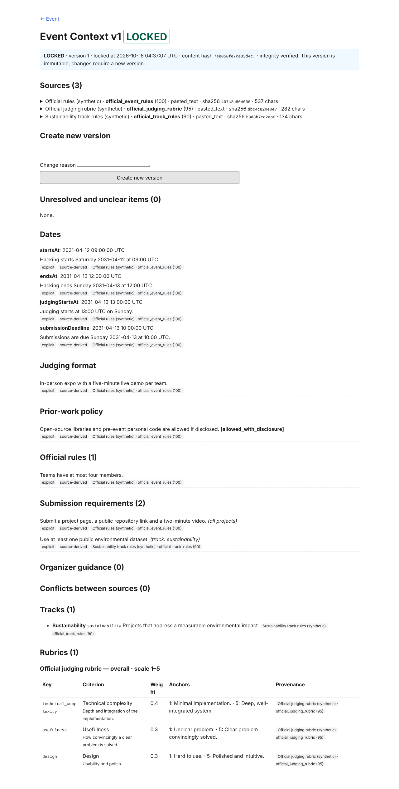
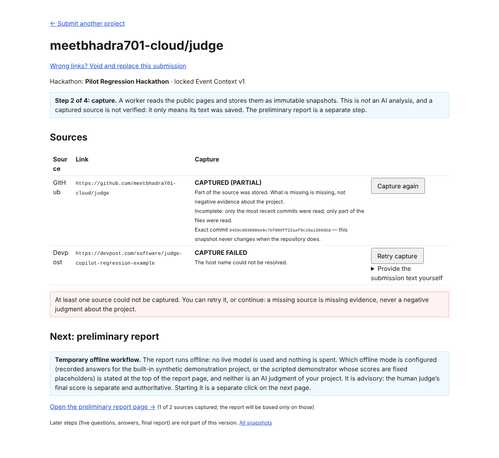
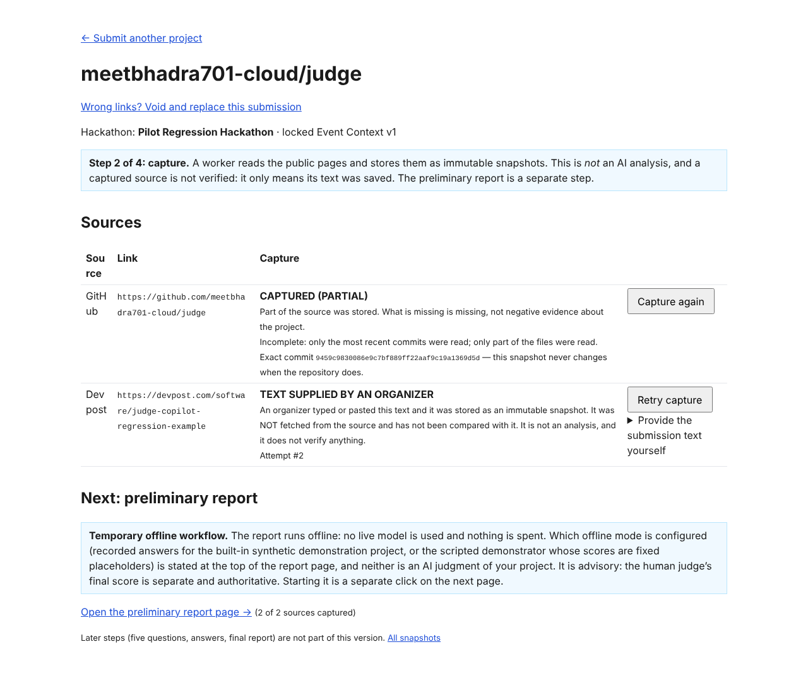
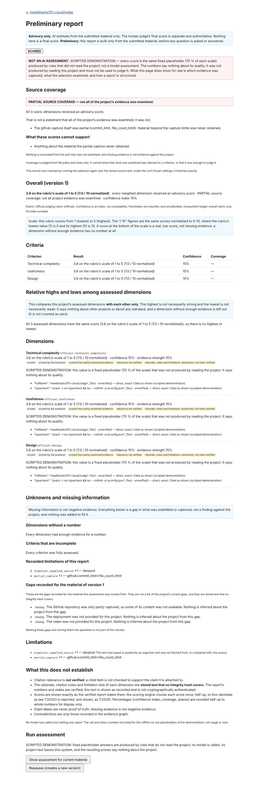

# P6C — first real-project end-to-end judging pilot

| Item                         | Value                                                                                                                                                                |
| ---------------------------- | -------------------------------------------------------------------------------------------------------------------------------------------------------------------- |
| Branch                       | `claude/p6c-real-project-pilot`, from the accepted R7F head. Nothing merged, nothing deployed, `main` untouched.                                                     |
| **Starting SHA**             | `1550e734937faa68385535b8179e153cb68338ba` (P6B-beta3-R2, passed R7F)                                                                                                |
| **Final implementation SHA** | `1c70dba7a6993ad77a51b2e2388763eba39b87f2` (all code, tests, fixtures, docs except this report; a report cannot contain the SHA of the commit that adds it)          |
| Live model / paid call       | **none.** No provider other than the offline scripted demonstrator and the offline replay provider exists in any code path used. No key, no network model, no spend. |
| Migrations                   | **none added.** No existing migration edited.                                                                                                                        |

```
P6C_OFFLINE_PILOT: PASS
REAL_SOURCE_END_TO_END: BLOCKED
```

The two verdicts are deliberately separate and are explained in §10. In one sentence: a judge can walk the whole interface in a real browser on **genuinely captured GitHub evidence** (recorded real GitHub
responses for a real public repository, through the production adapter), but **no real Devpost submission and no authentic event rubric could be obtained here**, so `REAL_SUBMISSION_DEMONSTRATION_BLOCKED`
and the real-source end-to-end claim is **not** made.

## 1. Workflow audit (what a person could actually do before this milestone)

Walked through the existing screens and code, honestly:

| Step                            | What worked                                                                                             | What was broken, missing or misleading                                                                                                                                                                                                                     | Action                                                                                                                                      |
| ------------------------------- | ------------------------------------------------------------------------------------------------------- | ---------------------------------------------------------------------------------------------------------------------------------------------------------------------------------------------------------------------------------------------------------- | ------------------------------------------------------------------------------------------------------------------------------------------- |
| Hackathon + Event Context       | Create event, draft version, pasted-text sources with authority, build, edit, lock (versioned, frozen). | Build needs an extractor; `none` (default) means a person must hand-edit the document, and `replay` answers only recorded fixtures. Nothing said so on the page.                                                                                           | Documented in the operator setup; the browser pilot uses the recorded synthetic regression event through the real screens. **Not rebuilt.** |
| Submit GitHub + Devpost         | Atomic idempotent submission, clear link errors.                                                        | —                                                                                                                                                                                                                                                          | none                                                                                                                                        |
| Capture + provenance            | Per-source status, retry, supplied Devpost text labelled as supplied.                                   | The capture row did not show **which commit** was captured (only the snapshot page did).                                                                                                                                                                   | Exact commit now shown on the capture row (`revision-github`), with a test.                                                                 |
| Preliminary assessment          | Request, verified read model, honest coverage panel.                                                    | **Replay answered only the built-in HydroTrack material**: any submitted project ended `replay_miss`. The only way to see a report on real captured material was impossible offline.                                                                       | New explicit offline `scripted` demonstrator (§3).                                                                                          |
| Capture page copy               | —                                                                                                       | Said the offline run "is expected to end without a report" — false once a project can be assessed offline, and it did not say which mode was configured.                                                                                                   | Mode-neutral copy; the report page states the mode.                                                                                         |
| Report page                     | Scores, citations, unknowns, limitations, coverage.                                                     | For a demonstration it printed "Model usage … $0.0250 / 11 settled calls", presenting placeholder counters as real spend. The banner repeated its own heading.                                                                                             | Replaced by "No model was called and nothing was spent…"; banner de-duplicated.                                                             |
| Assessing a rubric-only context | —                                                                                                       | **Accepted the request, queued a run, and failed it late** (`no_context_reference_evidence`) after pinning inputs (F-3). Also: events whose only explicit requirements are track-scoped could not be assessed from the submit page (it declares no track). | F-3 decision below. The failing browser journey (`fixture-e`) exposed the second point; it now uses a fixture with explicit global rules.   |
| Coverage integrity message      | —                                                                                                       | "failed its integrity checks" was shown even when the record merely **could not be checked** (source unreadable) — it accused the data.                                                                                                                    | Separate wording and test.                                                                                                                  |
| Operator prerequisites          | —                                                                                                       | No single page; no root `db:verify-schema` command (it existed only in the package).                                                                                                                                                                       | `docs/PILOT_OPERATOR_SETUP.md`; root `pnpm db:verify-schema`.                                                                               |

## 2. Real-source demonstration status

| Required input                               | Status                                                                                                                                                                                                                                                                                                                                                                                                                                                                                                                                                                                                                                                                                                                                               |
| -------------------------------------------- | ---------------------------------------------------------------------------------------------------------------------------------------------------------------------------------------------------------------------------------------------------------------------------------------------------------------------------------------------------------------------------------------------------------------------------------------------------------------------------------------------------------------------------------------------------------------------------------------------------------------------------------------------------------------------------------------------------------------------------------------------------- |
| Genuine public GitHub repo, immutable commit | **Yes, with a qualification.** `https://github.com/meetbhadra701-cloud/Judge` @ `9459c9830086e9c7bf889ff22aaf9c19a1369d5d` (the repository's own owner's, permission-appropriate), captured by the **production** GitHub adapter and SSRF-safe client, worker loop and database over **recorded real GitHub responses** (`tests/fixtures/real-github/`, recorded 2026-10-14, redaction of e-mail addresses only). A **live** capture attempt in this environment failed: `rate_limited` (anonymous quota exhausted on a shared IP; `scratchpad` manifest: first request HTTP 403, `rateRemaining: "0"`). The capture is `CAPTURED (PARTIAL)`: `commit_limit`, `file_count_limit` (the recording was made with 4 files, 5 commits); the page says so. |
| Matching real Devpost submission             | **No.** `devpost.com` is unreachable from this environment (`The host name could not be resolved`), and I was given no Devpost URL for this repository. I did not invent one.                                                                                                                                                                                                                                                                                                                                                                                                                                                                                                                                                                        |
| Organizer-authorized Devpost text            | **Not supplied.** The pilot test pastes text that begins `REGRESSION-TEST TEXT — NOT A REAL DEVPOST SUBMISSION.` through the real supplied-content screen. It proves the screen, labelling and provenance work; it is **not** evidence about any real submission.                                                                                                                                                                                                                                                                                                                                                                                                                                                                                    |
| Authentic event rubric                       | **Not available.** No real hackathon's official criteria, weights, rules or tracks were provided. The browser journey locks the repository's synthetic regression event (`fixture-a-clear-official-rubric`) by typing its sources through the real UI. Nothing was invented to stand in for a real rubric; it is labelled synthetic everywhere it appears.                                                                                                                                                                                                                                                                                                                                                                                           |

**`REAL_SUBMISSION_DEMONSTRATION_BLOCKED`.** Exact missing inputs, all three needed together:

1. the real Devpost project URL that belongs to a public GitHub repository the owner may share;
2. the text of that Devpost submission, pasted by someone authorized to share it (or a network path to `devpost.com` for the capture worker, which this environment's egress policy does not allow);
3. the hackathon's official judging criteria with weights, rules and tracks, as text with their authority (or an explicit statement that the event has none, in which case the context is refused up front — §4).

With those, the journey in `DEMO_RUNBOOK §1.10` produces the demonstration with no further engineering.

## 3. What was built

- **`ASSESSMENT_PROVIDER=scripted`** (`apps/worker/src/assessment/demonstration-model.ts`): a content-agnostic demonstrator. It extracts claims/evidence from whatever was captured (first usable line of each record), declares no relations, contradictions or unknowns, and gives
  **every dimension the same fixed placeholder (70 % of its scale)** citing the first two non-event records, with a rationale stating that it is a placeholder. It reads nothing semantically, so it cannot be mistaken for judgment, and the report page says so in a red `role="alert"` banner
  (`data-testid=demonstration-banner`, `data-mode=scripted`), in the version list, in the run section and in the API `notices.replay`. It is refused when `NODE_ENV=production` by the API environment validation, the worker environment validation and the runtime gate, and the structural scope test pins the allowed provider values and the production refusal.
- Everything else in the pipeline is the unchanged production pipeline: pins, coverage record and its recomputation, deterministic scoring, abstention, audit, the spending guard (the demonstrator reports placeholder usage; the UI no longer presents it as spend).
- Judge-facing: exact commit on the capture row, honest mode-neutral copy, limitation explanations (§4), no fake spend.
- Operator-facing: `docs/PILOT_OPERATOR_SETUP.md` (separate from the judge runbook), `docs/PILOT_USEFULNESS_CHECKLIST.md`, `DEMO_RUNBOOK §1.10`, `.env.example`, `ARCHITECTURE.md`.

## 4. Decisions on F-2, F-3, F-8 (least invasive)

| Finding                                                          | Decision                                                                                                                                                                                                                                                                                                                                                                                                                                                                                                                                                                                                                                                                                 | Tests                                                                                                                                                                                                                                                                                                                                                                                                                                                  |
| ---------------------------------------------------------------- | ---------------------------------------------------------------------------------------------------------------------------------------------------------------------------------------------------------------------------------------------------------------------------------------------------------------------------------------------------------------------------------------------------------------------------------------------------------------------------------------------------------------------------------------------------------------------------------------------------------------------------------------------------------------------------------------- | ------------------------------------------------------------------------------------------------------------------------------------------------------------------------------------------------------------------------------------------------------------------------------------------------------------------------------------------------------------------------------------------------------------------------------------------------------ |
| **F-3** rubric-only / empty-reference context                    | **Option 2 of `M5-P6A-decisions.md`: refuse early and clearly.** `AssessmentRunStore.requestAssessment` reads the pinned locked context (re-verified by hash), runs the same deterministic `buildEventReferenceItems` the worker uses, and answers `no_context_reference_evidence` → HTTP 422 `NO_CONTEXT_REFERENCE_EVIDENCE` with the remedy (add an explicit rule or requirement, or declare a track, in a new locked version) **before any run, pin, queue entry or spend exists**. Nothing is invented. The worker-side failure stays as defence in depth. Option 1 (an authenticated empty reference set) was not built: it changes the extraction contract and the trusted reader. | `assessment-run-store.test.ts` (rubric-only and unclear-only refused, nothing queued; explicit rule and declared-track-only proceed; PGlite + PG16), `routes.test.ts` (422 code, nothing queued), `pipeline.context.test.ts` (request refused). Fixtures in four other files now state one explicit rule, because a rubric-only context is no longer assessable — that is the intended contract.                                                       |
| **F-2** model-declared "insufficient" bypasses the critic        | **Option B (disclosure), not Option A (critic review).** The deterministic limitation `partial_score_excludes_model_declared_insufficient` (subjects = dimension ids, code-assigned only) is recorded when the overall or any criterion is partial **and** at least one dimension's disposition is `assessor_reported_insufficient`; the page says in words that the exclusion was the assessor's own unreviewed claim and that the partial number is not the project's overall score. **No change to `packages/scoring`; the 9.0 and 6.9 goldens are unchanged.** Option A needs critic prompt v2 and the F-4 feedback channel and stays a **blocker for any live use** (§8).           | `pipeline.f2-characterization.test.ts` (the CURRENT assertion flipped: limitation present with subject `hard_part`, number unchanged at 9.0 / `scored_partial` / share 0.7; fully scored 6.9 run carries none), `view.test.tsx` (attribution sentence shown only with the code). Not covered: "pre-gated by code → no limitation" has no dedicated fixture; the condition is by disposition and the characterization world has no pre-gated dimension. |
| **F-8** failed newer capture hidden while an older one is pinned | The read-time half already existed and is correct (`currency.newerCaptures`; a failure after pinning shows). The missing half was a failed attempt **before** the request. Added the limitation `newer_capture_unusable` (subject = source type) when a newer attempt of a pinned source `failed` or was `rejected`; the older capture is still assessed and no number changes.                                                                                                                                                                                                                                                                                                          | `pipeline.newer-capture.test.ts` (failed GitHub, rejected Devpost, no leak from another project, identical overall with and without the failed attempt; PGlite + PG16), `view.test.tsx` ("lowered no score"). A source whose only attempt failed keeps today's behaviour (unchanged tests).                                                                                                                                                            |

## 5. Browser walkthrough (`tests/browser/pilot.browser.ts`, real Chromium, real Next.js production build)

Every step uses only visible controls. No SQL, no hidden database edit, no script that bypasses the UI except two clearly separated "workers": the capture loop and the assessment loop are drained by the test as the operator's worker processes would run.

| #   | Step                                                                                                                                                                                                                                                                                                                                                                                               | Screenshot                                   |
| --- | -------------------------------------------------------------------------------------------------------------------------------------------------------------------------------------------------------------------------------------------------------------------------------------------------------------------------------------------------------------------------------------------------- | -------------------------------------------- |
| 1   | Home → **Create event** → **Create draft version** → add the three official sources (rules, judging rubric, track rules, each with its authority) → **Build context from sources** → review → **Lock context**                                                                                                                                                                                     |    |
| 2   | **Submit a project**: GitHub `https://github.com/meetbhadra701-cloud/Judge`, Devpost `https://devpost.com/software/judge-copilot-regression-example` → capture page. GitHub: `CAPTURED (PARTIAL)`, exact commit `9459c98…`, gaps listed as not negative evidence                                                                                                                                   |   |
| 3   | Devpost: `CAPTURE FAILED — The host name could not be resolved.` → **Provide the submission text yourself** → pasted regression text → `TEXT SUPPLIED BY AN ORGANIZER … NOT fetched from the source`                                                                                                                                                                                               |  |
| 4   | **Run assessment** → red `NOT AN AI ASSESSMENT` banner; coverage panel `PARTIAL SOURCE COVERAGE`; three dimensions each at the same placeholder with citations to the real repository's records (`"fullName": "meetbhadra701-cloud/Judge"` …); unknowns section; limitations with their explanations (`organizer_supplied_source`, `partial_capture`); "No model was called and nothing was spent" |   |

Note: the pasted `.../Judge` is shown and stored in its canonical lower-case form (`.../judge`); the recorded commit is the same. Observed quality of the **interface** (not of any AI judgment): the structure is complete and honest — what was captured and what was not, which text a person supplied, which numbers are placeholders. Observed weaknesses, not fixed here: the scripted citations are
trivial (first lines), so "claim → evidence" readability cannot be judged from them; the repository capture is limited to 4 files for the recorded world; the context build step needs an extractor that only exists for recorded fixtures, so a real hackathon's context currently has to be entered by hand-editing the draft JSON (**Edit draft**).

## 6. Fixtures and provenance

| Data                                                        | Origin                                                                                                                                                                 |
| ----------------------------------------------------------- | ---------------------------------------------------------------------------------------------------------------------------------------------------------------------- |
| `tests/fixtures/real-github/recorded-judge-9459c98.json`    | **Live capture** of real GitHub REST responses on 2026-10-14 for the public repository above (e-mail addresses redacted; see its README). Unchanged by this milestone. |
| `tests/fixtures/event-context/a-clear-official-rubric.json` | **Synthetic**, hand-written; the Event Context of the pilot. Not a real hackathon.                                                                                     |
| Devpost text in the pilot test                              | **Synthetic regression text**, labelled in its first line. Not a real submission and not proof of real-source ingestion.                                               |
| Scripted assessment output                                  | **Rules, not a model.** No recorded model output was used or created.                                                                                                  |
| `scratchpad` live capture manifest                          | The failed live attempt: HTTP 403 rate limit. Evidence that live capture was attempted, not a fixture.                                                                 |

## 7. Verification

| Gate                                                                                                        | Result                                                                                                                |
| ----------------------------------------------------------------------------------------------------------- | --------------------------------------------------------------------------------------------------------------------- |
| `pnpm check` (format, lint, typecheck, `db:check` incl. migration journal check, tests, build) at `1c70dba` | **exit 0.** PGlite: 219 test files passed, 6 skipped; **4,053 tests passed, 61 skipped, 2 todo, 0 failed.** Build OK. |
| Full suite on **PostgreSQL 16.15 (ICU)** (`TEST_DATABASE_URL`, `R5_DATABASE_URL`)                           | **225 files passed; 5,048 tests passed, 1 skipped, 4 todo; 0 failed.**                                                |
| `pnpm test:browser` (real Chromium, production Next.js build; `journey.browser.ts` + `pilot.browser.ts`)    | **2 files, 22 tests passed.** The journey test also asserts the checkout is left untouched.                           |
| `git diff --check`                                                                                          | clean                                                                                                                 |

First runs of the gates failed and were fixed (kept for honesty): two lint errors and four type errors in my own new tests; `assessment-ledger-contract`, `run-budget-store` and `assessment-coverage-store` fixtures used a rubric-only context that F-3 now refuses (each now states one explicit rule); the older browser journey used a fixture whose only explicit requirements are
track-scoped, which F-3 correctly refuses from the submit page (it declares no track) — switched to a fixture with explicit global rules; the structural scope guard `milestone-scope.test.ts` pinned the provider enum to `none | replay` and now pins `none | replay | scripted` **and** the production-refusal text (this edit was necessary and keeps the guard's intent: no live provider).

New focused tests: `assessment-run-store.test.ts` (F-3, PGlite+PG16), `routes.test.ts` (F-3 over HTTP), `pipeline.newer-capture.test.ts` (F-8, PGlite+PG16, 4 tests), `pipeline.f2-characterization.test.ts` (F-2, flipped CURRENT assertion), `pipeline.demonstration.test.ts` (scripted provider through the real pipeline), `runtime-gate.test.ts` (scripted gate, production refusal), `view.test.tsx` (F-2/F-8 explanations, integrity wording), `capture/view.test.tsx` (exact commit, mode-neutral copy), `tests/browser/pilot.browser.ts` (the pilot journey).

Mutation proofs were **not** re-run in this milestone (no scoring, hashing or verification code changed; `packages/scoring` and the report hash are untouched).

Environment note: the PG16 cluster was recreated for this run (`pg_createcluster 16 icu --locale-provider=icu`), not inherited from earlier sessions. Live GitHub was attempted once and rate-limited; Devpost is unreachable; no other network was used.

## 8. Remaining production blockers and R7F P3 carry-forward

Production is **not** ready; the isolated offline demonstration is unaffected by any of these. Table with status in `docs/PILOT_OPERATOR_SETUP.md` ("Production-readiness checklist"): startup schema check inspects names not definitions (open); some runtime roles lack
migration-ledger permissions (open, documented); root `db:verify-schema` (**fixed**); migration 0020 history handling (open, documented); concurrent cold verification reads (open); coverage-integrity wording (**fixed**). The task text named six of the nine R7F P3 findings; the other three were not
supplied and are **not reproducible from the repository** — they must be copied from the R7F report. Additional blockers for any live use: F-2 Option A and critic prompt v2/F-4; a provider adapter, live gate, verified price table, human confirmation of paid runs
(`P6B_PREFLIGHT_PLAN.md`); an extractor for real Event Context documents (today only recorded fixtures or manual editing); track declaration on the submit page (a project with track-scoped requirements cannot declare its track from the UI).

## 9. Requirements for the first authorized live-model experiment

A separate decision. Preconditions: owner authorization and a hard spend cap; the real inputs of §2; F-2 Option A with critic prompt v2 designed together with F-4 (feedback channel to the assessor); provider adapter contract-tested on recorded HTTP; `assertProviderAllowed('live')` gated by explicit configuration **and** an approval flag; `prices/v2` verified by the owner; human confirmation of each paid run
showing the preflight estimate; the first-measurement protocol (tiny synthetic project, human review of every output, `PILOT_USEFULNESS_CHECKLIST.md` part B); one worker host. Not started.

## 10. Verdicts

**`P6C_OFFLINE_PILOT: PASS`** — a judge can, in a real browser and through visible controls only, create an event, enter and lock its official sources, submit a GitHub and a Devpost URL, have the GitHub repository captured (production adapter) at an immutable commit with its limits stated, supply Devpost text with provenance labelled, request an offline scripted assessment and open a report whose every
demonstration label is correct; F-2, F-3 and F-8 have decisions and tests; all gates pass (§7).

**`REAL_SOURCE_END_TO_END: BLOCKED`** — real GitHub evidence is proven only as recorded real responses (the live attempt was rate-limited), no real Devpost submission or authorized text and no authentic event rubric exist here (§2). Not `PROVEN`: the Devpost half and the rubric half were never real. Not merely `UNVERIFIED`: the exact missing inputs are known and listed.
